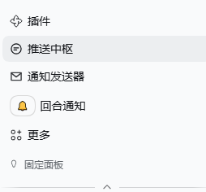

# dsh-nav-pins — 侧栏面板：一条细线收起，固定选择永久记住

把 DSH 左侧「全局面板」那一列收成一条细线 —— 点一下收成一排图标，再点一下回到熟悉的列表。
更关键的是：**哪些面板固定、哪些收起，选择会真的落盘，重启 DSH 之后还是你上次的样子。**

- 适合谁：面板很多、侧栏太长、每次启动都要重新摆一遍的用户。
- 解决什么：DSH 自带的 panel pin 是**纯内存**的（插件重载 / 重启就回到全部显示），本插件把这份选择交给 DSH 的配置服务，写进 profile 的 `cordis.patch.yml`，重启不丢。

---

## 界面截图



> 上图为真机实拍（本机 DSH 桌面版）。截图里的账号名、ID、发送记录已做像素化处理，只保留界面结构。

> 只想快点装起来？直接看根目录的 [INSTALL.txt](INSTALL.txt)：三步安装 + 三处验证 + 配置在哪 + 怎么卸。

---

## 目录

- [界面截图](#界面截图)
- [它做了什么](#它做了什么)
- [零基础安装](#零基础安装)
- [第一次使用（三步）](#第一次使用三步)
- [逐项功能说明](#逐项功能说明)
- [完整操作示例](#完整操作示例)
- [配置文件详解](#配置文件详解)
- [工作原理（技术参考）](#工作原理技术参考)
- [排错手册](#排错手册)
- [FAQ](#faq)
- [版本更新简介](#版本更新简介)
- [已知限制与安全说明](#已知限制与安全说明)
- [目录结构 / 开发 / 许可](#目录结构--开发--许可)

---

## 它做了什么

| 能力 | 表现 |
| --- | --- |
| 折叠细线 | 面板列表底部有一条细线（两侧渐隐 + 一个箭头）。点它，面板收成一排 36px 图标；再点一下，回到带文字的列表。折叠/展开状态本机记住。 |
| 固定管理 | **展开时**列表里有一个「📌 固定面板」入口，点开是勾选弹窗；取消勾选的面板立刻从侧栏收起。 |
| 折叠时无固定按键 | 收成图标行时，「固定面板」入口与每行的取消固定按钮**都消失**（`display:none`，不是透明）。 |
| 永久记住 | 勾选结果写入插件配置 `hiddenPanels`，落盘到 profile 的 `cordis.patch.yml`。重启 DSH 后依然生效。 |
| 「插件」面板不可收起 | 对应 DSH 的 `FIXED_PANEL_ID = 'plugins'`，弹窗里标注「始终显示」，复选框禁用。 |

> 说明：本插件**不**调用 DSH 自己的内存 pin（`setPinned`）。它自己维护一份 `hiddenPanels` 并用 DOM 隐藏面板行，所以宿主怎么重置 pin 都不影响你的持久化选择。

---

## 零基础安装

本插件是本地插件（`link:` 方式），跟 `@duma520/dsh-push-hub` 等同一套路。

1. **确认文件在位**：`<插件根目录>\dsh-nav-pins\package.json` 存在。
2. **在 profile 里登记依赖**：编辑 `<用户目录>\.dsh\profiles\desktop\package.json`
   - `dependencies` 里加一行：`"@duma520/dsh-nav-pins": "link:<插件根目录>/dsh-nav-pins",`
   - `dsh.profile.bundles` 数组里加一项：`"@duma520/dsh-nav-pins",`
3. **建符号链接**（让 node 能解析包名）：
   `<用户目录>\.dsh\profiles\desktop\node_modules\@duma520\dsh-nav-pins` → `<插件根目录>\dsh-nav-pins`
   （Windows 用 junction 即可，不需要管理员权限。）
4. **加实例到 profile 配置**：编辑 `<用户目录>\.dsh\profiles\desktop\cordis.patch.yml`，在任意一个兄弟实例旁边加：

   ```yaml
   - id: nav-pins
     name: "@duma520/dsh-nav-pins"
     config:
       hiddenPanels: []
   ```

5. **重启 DSH**（不是刷新页面，是退出再开）。

> ⚠️ `id: nav-pins` 这个 id 是硬约定：浏览器半身用它去 `ctx.configForms.get('nav-pins')` 取配置。**改了 id 必须同步改 `lib/client.js` 里的 `ENTRY_ID`**，否则配置永远读不到，会退回本机 localStorage 兜底。

如果之前装过 `dsh-nav-fold`：请从 `dependencies`、`dsh.profile.bundles`、`cordis.patch.yml` 三处一起摘掉（本插件已取代它）。两套同时启用会导致两套折叠按钮互相打架。

---

## 第一次使用（三步）

1. 打开 DSH，看左侧面板列表底部 —— 应该有一条**两侧渐隐的细线**，中间一个小箭头。
2. **点细线**：面板收成一排图标。此时**没有**任何固定按钮（这是设计）。
3. **再点一次细线**（箭头朝上）：回到带文字的列表；列表里多出「📌 固定面板」一行；点它，勾选你想留在侧栏的面板。

---

## 逐项功能说明

### 细线（`button[data-nav-pins-toggle]`）

| 项 | 取值 | 推荐 | 什么时候改 |
| --- | --- | --- | --- |
| 折叠 / 展开 | 点一下切换 | 面板多就默认折叠 | —— |
| 记忆位置 | `localStorage['dsh-nav-pins:collapsed']` = `collapsed` / `expanded` | 不用管 | 想恢复默认折叠：删掉这个键 |
| 无障碍标签 | `aria-label` = 「展开全局面板 / Expand global panels」或「折叠全局面板 / Collapse global panels」 | —— | —— |
| 初始态 | 默认 `collapsed`（收成图标） | —— | —— |

### 「📌 固定面板」入口（`button[data-nav-pins-manager]`）

- **只在展开态出现**；折叠态 CSS `display:none`。
- 点开一个居中弹窗，逐面板一行复选框：
  - 勾上 = 面板留在侧栏（= 不在 `hiddenPanels` 里）
  - 取消 = 面板从侧栏收起（= 加进 `hiddenPanels`）
- 「插件 / Plugins」一行带「始终显示」，复选框禁用。
- 每次勾选**立即**写盘，弹窗底部会显示「已保存到插件配置，重启后继续生效。」或降级提示。
- `Esc` 或点遮罩关闭。

### 隐藏的宿主按钮

| 宿主元素 | 处理 | 为什么 |
| --- | --- | --- |
| 每行「取消固定」按钮（`class*="panelUnpin"`） | `display:none !important` | 它默认 `opacity:0`、hover 才显形；折叠成图标时若仍能 hover 出现，就是用户抱怨的「细线上出现是否固定按键」。用 `display:none` 才能彻底不出现。 |
| 自带「更多」菜单里的固定行 | （本插件不隐藏） | 本插件用 id 精确匹配，用户若从那里操作也不会制造重复勾选；但两份状态互不影响，建议统一用本插件的弹窗。 |

---

## 完整操作示例

### 场景 1 · 只想让侧栏短一点（最简单）

面板 8 个，只想留 3 个。

1. 点细线展开列表（若当前是展开态，跳过）。
2. 点「📌 固定面板」。
3. 取消勾选不想要的 5 个 → 它们立刻消失。
4. 关掉弹窗，点细线收成图标。
5. 重启 DSH → 侧栏还是这 3 个。

### 场景 2 · 换着用（常见组合）

白天要「会话 + 文件」，晚上做插件开发要「插件 + 设置」。

1. 打开弹窗，把白天不需要的取消 → 保存。
2. 要做别的事时再打开弹窗重新勾。
3. 每次都会立刻落盘，不用点「保存」按钮（也没有这个按钮）。

### 场景 3 · 键盘操作（进阶）

1. `Tab` 走到细线 → `Enter` 折叠。
2. `Tab` 走到「固定面板」→ `Enter` 打开弹窗。
3. 弹窗打开时焦点自动落在第一个可用复选框；`Space` 勾选；`Esc` 关闭。

---

## 配置文件详解

### `<插件根目录>\dsh-nav-pins\cordis.patch.yml`

```yaml
- insert:
    - id: nav-pins
      name: '@duma520/dsh-nav-pins'
      config:
        hiddenPanels: []
```

### 插件配置字段（Host 半身 `lib/index.js`）

| 字段 | 类型 | 默认 | 取值 | 改错会怎样 |
| --- | --- | --- | --- | --- |
| `hiddenPanels` | `string[]`（`Schema.array(String)`，`.volatile()`） | `[]` | 面板 id 列表，例如 `["files","plugins"]` 的**反集**语义：在里面 = 收起 | 写进不存在的 id 只是无效项（不报错）；写 `"plugins"` 会被前半身 sanitize 掉 |

> `.volatile()` 是必须的：schemastery 的非 volatile 字段一改会**重启整个插件**；volatile 字段原地更新。用户勾一下就重启插件显然不可接受。

### 落盘后的样子（`<用户目录>\.dsh\profiles\desktop\cordis.patch.yml`）

```yaml
- id: nav-pins
  name: "@duma520/dsh-nav-pins"
  config:
    hiddenPanels:
      - files
      - sessions
```

### 本机兜底存储（配置服务不可用时才用）

| 键 | 值 |
| --- | --- |
| `dsh-nav-pins:collapsed` | `"collapsed"` / `"expanded"` |
| `dsh-nav-pins:hiddenPanels` | JSON 数组，如 `["files"]` |
| `dsh-nav-pins:labels` | `{面板id: 标题}` 缓存，用于宿主过滤行时按标题兜底匹配 |

---

## 工作原理（技术参考）

### 挂载

```js
window.__ModuleLoader__.load({ id: '@duma520/dsh-nav-pins', factory: (require) => { ... } });
module.exports.inject = ['slots', 'configForms'];
module.exports.apply = apply;
```

`apply(ctx)` 整体包在 `ctx.effect(() => {...}, 'dsh-nav-pins: panel fold + pins')` 里，返回的 cleanup 会卸掉 Observer、监听、注入的按钮与 `<style>`。

### 定位目标导航

```js
const NAV_SELECTOR = 'nav[class*="panelList"]';
const NAV_LABEL = /^(全局面板|Global panels)$/;
```

CSS `class` 用**子串匹配**（`[class*="panelRow"]`），不依赖 hash 前缀，宿主升级改 hash 也不会立刻失效。

### 面板 id ↔ DOM 行对齐

1. `ctx.slots.entriesOfSlot('sidebar.panellist')` 取注册项，按 `options.order` 升序 → id 数组（与宿主内部 `panels` store 的排序一致）。
2. DOM 侧取 `button[class*="panelRow"]`，**排除** `aria-haspopup`（宿主的「更多」按钮）与本插件插入的两个按钮。
3. 数量相等 → 按下标一一对应；数量不等（宿主按内存 unpinned 过滤了行）→ 用 `labels` 缓存按 `aria-label` 兜底匹配，并在弹窗里提示「收起效果可能短暂不准」。

### 持久化

```js
const form = ctx.configForms.get('nav-pins');
const snap = form.getSnapshot();        // { status:'ready', value:{ hiddenPanels: [...] }, writable, revision }
await form.set('hiddenPanels', list);   // Promise<boolean>，false = 写入失败
form.subscribe(() => { /* 外部改动时同步 */ });
```

写入最终走 `ctx.remote.settings.mutate(namespace, ops, revision)`，由 DSH 落盘到 profile 配置。`form.set` 返回 `false` 时本插件会退回 `localStorage` 并在弹窗里说明。

### 变更监听

`MutationObserver(document.body, { childList:true, subtree:true, attributes:true, attributeFilter:['aria-label','class'] })` + 去抖（`setTimeout(0)`）→ `sync()`。侧栏重渲染时会自动补回按钮并重新套用隐藏。

---

## 排错手册

| 现象 | 原因 | 解决 |
| --- | --- | --- |
| 侧栏底部没有细线 | 插件没加载 | 查 `cordis.patch.yml` 是否有 `- id: nav-pins`；查 `node_modules/@duma520/dsh-nav-pins` 链接是否存在；重启 DSH |
| 有细线，但点「固定面板」弹窗是空的 | `entriesOfSlot('sidebar.panellist')` 还没注册完 | 折叠再展开一次；或重启；仍旧空说明侧栏插件版本变了 |
| 勾选后重启又全部显示 | 配置没写进去（`form.set` 返回 false） | 看弹窗底部提示；检查 `cordis.patch.yml` 是否有 `hiddenPanels:`；确认实例 id 是 `nav-pins`（不是别的） |
| 折叠时还能看到固定按钮 | CSS 被覆盖 | 确认 `<style data-plugin-css="dsh-nav-pins">` 在 `<head>` 里；本插件用 `display:none !important`，优先级已最高 |
| 收起的面板又冒出来 | 宿主重新渲染了那一行 | 正常情况下 Observer 会补；若持续出现，看 `nav.dataset.navPinsAligned` 是否为 `false` |
| 出现两个折叠按钮 | `dsh-nav-fold` 没摘干净 | 从 `dependencies` / `bundles` / `cordis.patch.yml` 三处一起删 |

日志在哪：DSH 桌面版日志在 `%APPDATA%\@deepseek-ai\dsh-desktop\`；浏览器半身的报错在 DevTools Console（本机启动参数没有 `--remote-debugging-port`，需人工开 DevTools）。

---

## FAQ

1. **和 `dsh-nav-fold` 能共存吗？** 不能，两个都会往面板列表插按钮。本插件已取代它。
2. **为什么不直接用宿主自带的 pin？** 因为它是 `createPanelPins()` 纯内存实现，插件重载就清空 —— 正是「每次启动都全部显示」的根因。
3. **固定集合存在哪？** 优先 `cordis.patch.yml` 的 `hiddenPanels`；配置服务不可用时退回 `localStorage['dsh-nav-pins:hiddenPanels']`。
4. **「插件」面板能收起吗？** 不能。宿主 `FIXED_PANEL_ID = 'plugins'`，强行收起会让设置入口消失。
5. **折叠状态也会持久化吗？** 会，存 `localStorage['dsh-nav-pins:collapsed']`，默认 `collapsed`。
6. **支持远程控制页吗？** 本插件作用于侧栏面板列表；RDS 侧若渲染同一侧栏，同样生效。
7. **面板改名后选择会丢吗？** 不会。存储的是 id 不是标题；标题缓存只用于兜底匹配。
8. **能拖动排序吗？** 本版本不做排序（`dsh-nav-fold` 有），避免与其拖拽逻辑冲突。
9. **勾选后需要点保存吗？** 不需要，也没有保存按钮（实时落盘）。
10. **卸载会留下什么？** `cordis.patch.yml` 里那 4 行实例块 + 3 个 localStorage 键。删掉即可。

---

## 版本更新简介

> **开源发布**：本仓库于 2026-11-21 首次公开，内容与 v0.1.1 一致（版本号未变，仅做脱敏与发布动作，按归档号记录）。详见[软件升级迭代记录](软件升级迭代记录.md)最新一段。

| 版本 | 日期 | 一句话变更 |
| --- | --- | --- |
| v0.1.1 | 2026-11-20 | 修复：折叠箭头改为 CSS 双图切换、属性写入加同值守卫，消除自触发重绘空转；新增无头冒烟测试（155 项） |
| v0.1.0 | 2026-11-20 | 首版：细线折叠 + 折叠态无固定按键 + 「固定面板」弹窗 + `hiddenPanels` 落盘持久化 |

---

## 已知限制与安全说明

- **依赖宿主 DOM 结构**：靠 `class*="panelList"` / `panelRow` / `panelEntry` / `aria-label`。宿主大改 DOM 时需要跟进。
- **行对齐依赖数量相等**：宿主若按内存 unpinned 过滤掉行，会用标题缓存兜底，可能短暂不准（弹窗会提示）。
- **不接管宿主「更多」菜单里的固定行**：那份状态是内存的，与插件无关；建议只用本插件弹窗。
- **安全**：不联网、不读凭据、不写文件；只读写自己的配置字段与三个 localStorage 键。

---

## 目录结构 / 开发 / 许可

> **开源仓库说明**：本仓库只放插件本体（`lib/`、`cordis.patch.yml`、`package.json`、`README.md`、`docs/`、`LICENSE`、`config.example.json`、迭代记录与界面截图）。**`scaffold/`（开发探针与回归脚本）和 `version/`（历次备份快照）不在仓库里** —— 它们绑定本机路径、本机真实账号与历史数据，公开即泄露。下文凡是 `node scaffold/...` 之类的命令都只在作者本机跑得通，clone 本仓库后这些文件并不存在。

```
dsh-nav-pins/
├── package.json          # dsh.bundle.patch + dsh.client 声明
├── cordis.patch.yml      # 挂载 Host 半身的 insert 段
├── lib/
│   ├── index.js          # Host 半身：Schema 配置项
│   └── client.js         # 浏览器半身：折叠 + 固定弹窗 + 落盘
├── scaffold/
│   └── smoke_test.cjs    # 无头冒烟测试（最小 DOM 影子对象，不装依赖）
├── README.md
├── 软件升级迭代记录.md
└── version/              # 历次改动备份
```

- 语法自检：`node --check lib/index.js && node --check lib/client.js`
- 回归测试：`node scaffold/smoke_test.cjs`（应输出「检查项 155 条，失败 0 条 / 结果：ALL PASS」）
- 无构建步骤（手写 ModuleLoader bundle，零依赖）。
- 许可：MIT。

> 冒烟测试只覆盖逻辑与 DOM 契约（注入、对齐、隐藏、写盘、清理）；细线的视觉外观与图标排布必须在 GUI 里人工目视，测试里没有 CSS 引擎。

## 许可

本项目采用 **GNU Affero General Public License v3.0（AGPL-3.0）** 发布。

- 完整许可证条文见仓库根目录 [LICENSE](LICENSE)。
- 你可以自由使用、修改、分发，包括用于商业用途，无需另行获得授权。
- 若你修改后分发，或以网络服务方式提供本软件，必须按 AGPL-3.0 公开相应源代码。
- 本仓库自 2026-11-23 起改用 AGPL-3.0；此前已按 MIT / BSD-3-Clause 发布的版本，其接收者依原许可证获得的授权继续有效。
